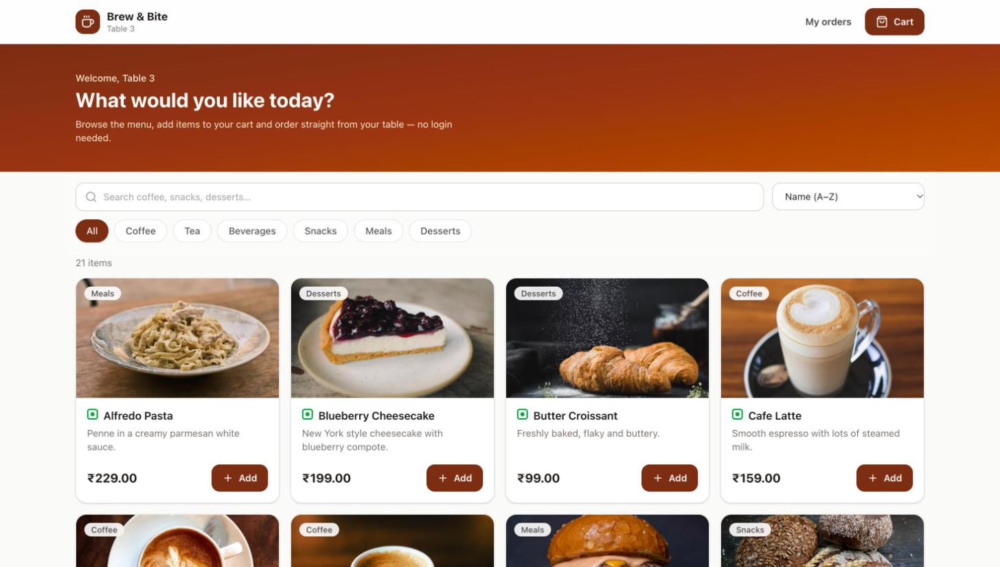
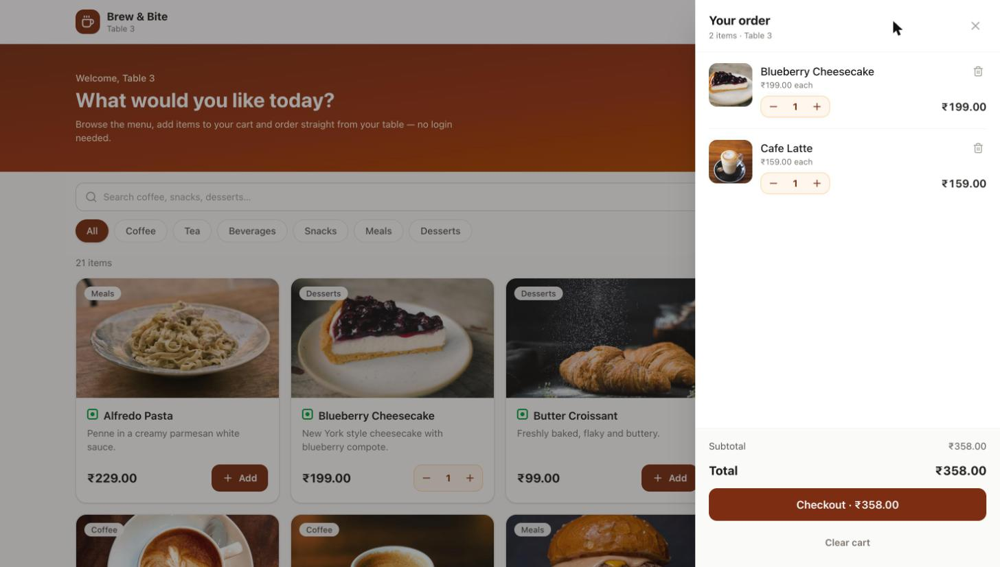
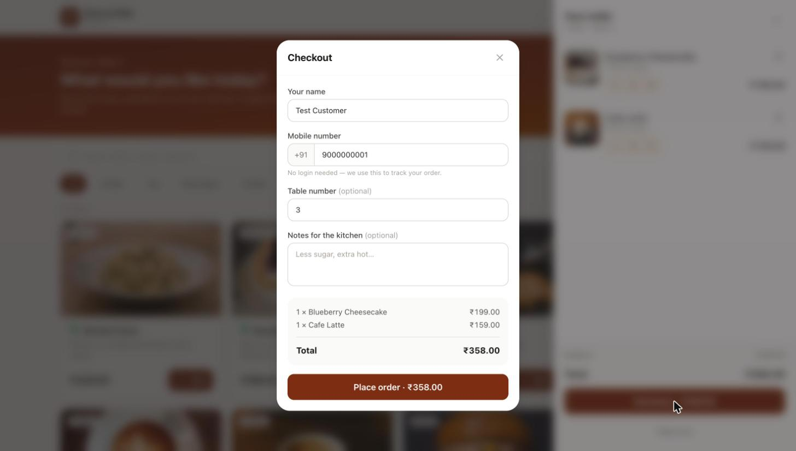
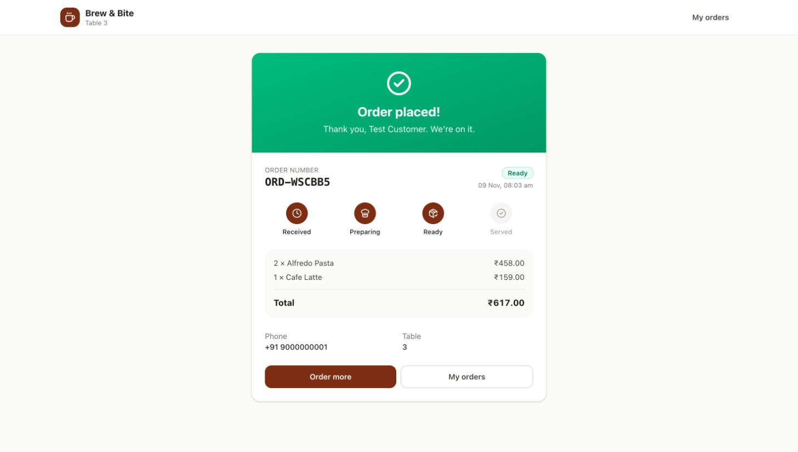
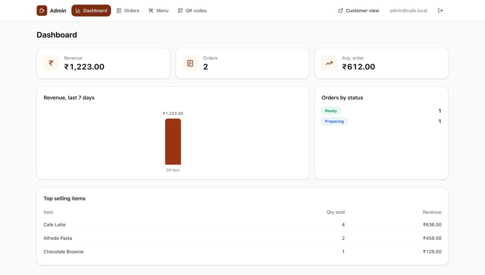
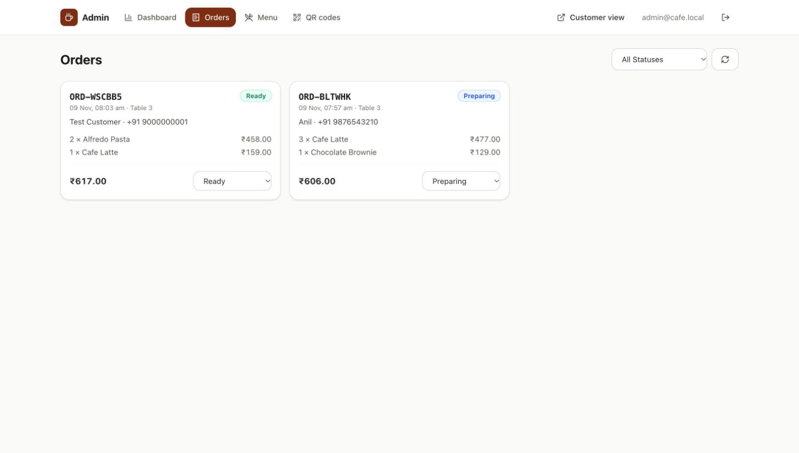
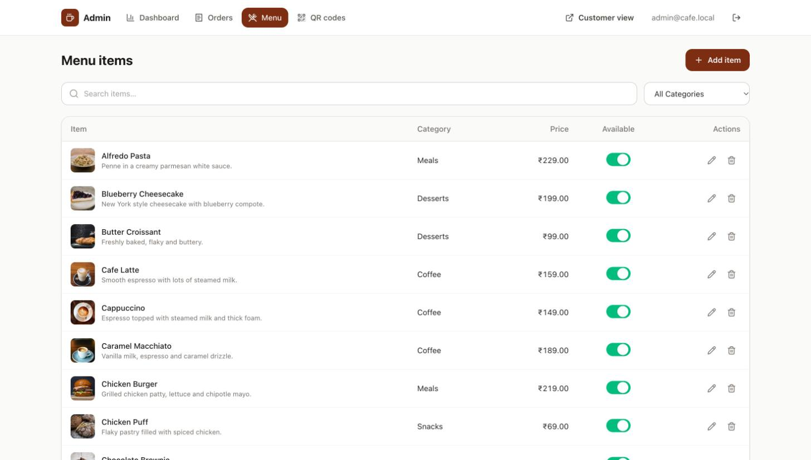
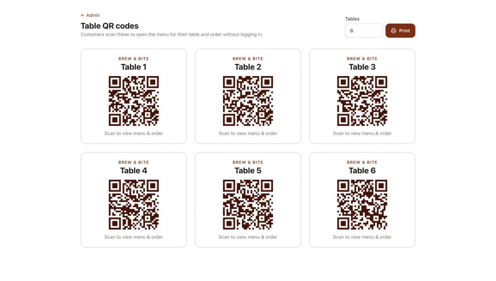

# Brew & Bite — Cafe Ordering (Frontend)

React frontend for a MERN cafe ordering system. Customers scan the QR code on their table, browse the menu, add items to a cart and order with just a name and phone number. There's no login. Staff use an admin panel to manage the menu, move orders through the kitchen and see sales stats.

> **Backend / REST API:** [anildeveloper26/cafe-order-api](https://github.com/anildeveloper26/cafe-order-api)

| | Link |
|---|---|
| **Live app (Vercel)** | `https://<your-app>.vercel.app` |
| **Live API docs** | `https://<your-api>.onrender.com/api/docs` |

## Features

**Customer (no login)**
- Scan a table QR code (`/menu?table=N`). A welcome pop-up opens and the table number is remembered.
- Responsive menu with **debounced search**, **category filters** and **price sorting**. All three are kept in the URL.
- **Cart** drawer with quantity updates, item removal and a live total. The cart is saved in localStorage and checked against the live menu on load.
- **Checkout** pop-up that collects name, a 10-digit mobile number (a pasted `+91` is stripped), table and notes. Validation runs in the browser and on the server.
- **Order tracking** page with a live status timeline over Socket.io: Received, Preparing, Ready, Served.
- **My orders** lookup by phone number.
- Loading skeletons, empty states, error states with retry, toasts, and a "waking server" notice for Render cold starts.

**Admin (`/admin`, JWT)**
- Dashboard: revenue, order count, average order value, 7-day revenue chart, orders by status and top-selling items.
- Menu CRUD with search and category filter. The availability toggle updates instantly and undoes itself if the server rejects it.
- Live orders board: new orders appear in real time with a toast, and each order has a status dropdown.
- Printable table QR codes (`/admin/qr`).

## Tech stack

React 19 · TypeScript · Vite · Tailwind CSS v4 · React Router 7 (data router) · TanStack Query 5 · Zustand · Axios · Socket.io client · qrcode.react · tailwind-merge · oxlint

## Project structure

```
src/
├── app/           # App, providers (QueryClient, Toaster, Devtools), query client config, auth wiring
├── routes/        # ROUTING ONLY: paths.ts, router.tsx (route objects + lazy pages), guards/
├── layouts/       # CustomerLayout, AdminLayout (+ header/nav)
├── pages/         # thin route screens that compose features (customer/, admin/)
├── features/      # domain modules, each with api/ hooks/ components/ (store/) + index.ts
│   ├── menu/  cart/  orders/  auth/  dashboard/  table/  qr/
├── components/
│   ├── ui/        # reusable kit: Button, Input, Select, FormField, Modal, Drawer, ConfirmDialog, Card,
│   │              # Badge, Switch, Skeleton, EmptyState, ErrorState, SearchInput, ChipGroup, QuantityStepper
│   └── common/    # ItemImage, VegBadge, BrandLogo, WakingBanner, FullPageSpinner
├── hooks/         # useUrlState, useDebouncedInput, useDebounce, useSlowLoading
├── lib/           # http client, errors, socket, storage, format, env, cn
├── constants/     # queryKeys, endpoints, menu/order constants, validation, storage keys
└── types/         # API, menu, order, stats types
```

### Architecture

- **Query management (TanStack Query):**
  - One key factory (`constants/queryKeys.ts`) for all queries.
  - 30s stale time.
  - Network and 5xx errors retry with backoff, which covers Render cold starts.
  - `keepPreviousData` on filtered lists.
  - Mutations invalidate the keys they affect. The availability toggle and order status change update optimistically and roll back on error.
  - Socket.io events write straight into the query cache.
- **Route persistence:**
  - Search, category, sort, table, admin filters and the phone lookup live in the URL (`useUrlState`), so they survive refresh, back/forward and shared links.
  - Admin login returns you to the exact URL you requested, query string included.
  - Scroll restoration, a router error boundary (it handles stale chunks after a deploy) and a 404 route.
- **Rules:**
  - Pages never call the API directly. They use feature hooks.
  - Features expose a public `index.ts`.
  - Route strings live only in `routes/paths.ts`, and API paths only in `constants/endpoints.ts`.

## Getting started

Prerequisites: Node.js 20+ and the [backend](https://github.com/anildeveloper26/cafe-order-api) running locally or deployed.

```bash
git clone https://github.com/anildeveloper26/cafe-order-web.git
cd cafe-order-web
cp .env.example .env        # point VITE_API_URL at your backend
npm install
npm run dev                 # http://localhost:5173
```

Open `http://localhost:5173/menu?table=3` to try the QR flow, or `http://localhost:5173/admin` for the admin panel.

## Environment variables

| Variable | Description |
|---|---|
| `VITE_API_URL` | Backend API base URL, e.g. `https://your-api.onrender.com/api` |
| `VITE_SOCKET_URL` | Socket.io origin, e.g. `https://your-api.onrender.com` |
| `VITE_PUBLIC_URL` | Public URL of this app, used inside the table QR codes (defaults to the current origin) |

## Scripts

| Command | What it does |
|---|---|
| `npm run dev` | Vite dev server |
| `npm run build` | Type-check + production build |
| `npm run preview` | Serve the production build |
| `npm run lint` | Lint with oxlint |
| `npm run typecheck` | Type-check only |

## Deployment (Vercel)

1. Import this repo in Vercel. Use the framework preset **Vite**.
2. Set `VITE_API_URL`, `VITE_SOCKET_URL` and `VITE_PUBLIC_URL`.
3. `vercel.json` rewrites every route to `index.html`, so links like `/menu` and `/admin/orders?status=ready` work on refresh.
4. On the backend, add your Vercel URL to `CORS_ORIGIN`.

A `Dockerfile` (Vite build served by nginx with an SPA fallback) is included for container deploys.

## Testing

End-to-end tests (Playwright, API + browser) live in the [backend repo](https://github.com/anildeveloper26/cafe-order-api#testing) because they start both apps against an in-memory MongoDB. Clone the two repos side by side and run `./run-e2e.sh` from `cafe-order-api`.

## Screenshots

| Menu | Cart |
|---|---|
|  |  |

| Checkout (no login) | Order tracking (live status) |
|---|---|
|  |  |

| Admin dashboard | Admin orders |
|---|---|
|  |  |

| Admin menu (CRUD) | Table QR codes |
|---|---|
|  |  |
